# Evidencias del despliegue en el servidor Linux

Capturas del despliegue de PromElec en el VPS de Hostinger (Ubuntu 24.04), tomadas el 25 de noviembre de 2026 siguiendo [Despliegue.md](../Despliegue.md). La API corre en dos instancias detrás de Nginx, publicada en `https://45.132.240.125:8443`.

| # | Archivo | Qué demuestra |
|---|---|---|
| 1 | [01-firewall-hostinger.png](01-firewall-hostinger.png) | Firewall: solo 22, 80, 443, 8443 y 8088 abiertos; el resto se descarta |
| 2 | [02-docker-compose-up.png](02-docker-compose-up.png) | La imagen de Docker Hub se descarga y las dos instancias quedan *healthy* |
| 3 | [03-compose-ps-y-nginx-t.png](03-compose-ps-y-nginx-t.png) | Contenedores en ejecución y configuración de Nginx válida |
| 4 | [04-redireccion-y-cabeceras-terminal.png](04-redireccion-y-cabeceras-terminal.png) | HTTP responde 301 hacia HTTPS, balanceo, cabeceras de seguridad y consumo de memoria |
| 4b | [04b-redireccion-location.png](04b-redireccion-location.png) | Destino de la redirección: `Location: https://45.132.240.125:8443/...` |
| 5 | [05-balanceo-x-upstream.png](05-balanceo-x-upstream.png) | Balanceo de carga: `X-Upstream` alterna entre las dos instancias |
| 6 | [06-cabeceras-seguridad-navegador.png](06-cabeceras-seguridad-navegador.png) | Cabeceras de seguridad vistas desde el navegador (respuesta 200 por HTTP/2) |
| 7 | [07-tolerancia-fallas.png](07-tolerancia-fallas.png) | Con una instancia apagada, todas las respuestas siguen siendo 200 |
| 8 | [08-docker-stats.png](08-docker-stats.png) | Memoria usada por cada contenedor frente a su límite |
| 9 | [09-navegador-catalogo.png](09-navegador-catalogo.png) | El catálogo publicado en internet por HTTPS |
| 10 | [10-docker-hub.png](10-docker-hub.png) | La imagen publicada en Docker Hub: `marianasilcam05/promelec-api` |

---

## 1. Firewall del VPS

Solo se aceptan los puertos 22 (SSH), 80 y 443 (servicios existentes) y 8443 y 8088 (PromElec). La última regla descarta todo lo demás.

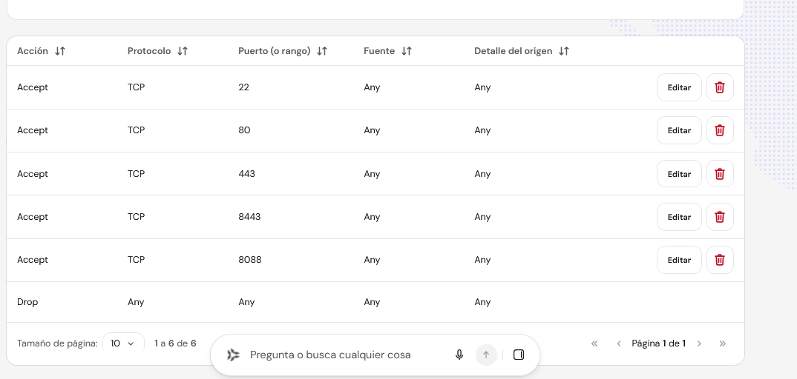

## 2. Despliegue con `docker compose`

`docker compose pull` descarga `marianasilcam05/promelec-api:1.1` desde Docker Hub. Compose crea una red y dos volúmenes propios, arranca la instancia 1, espera a que esté sana, arranca la instancia 2 y al final Nginx.

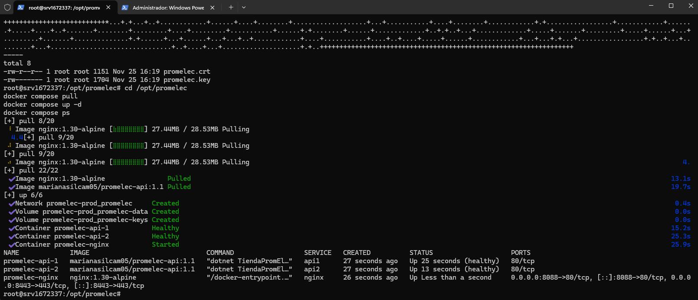

## 3. Contenedores y configuración de Nginx

Las APIs solo exponen `80/tcp` dentro de la red de Docker. Únicamente Nginx publica puertos (8088 y 8443). `nginx -t` confirma que la configuración es válida.

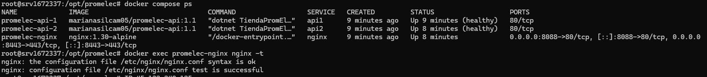

## 4. Verificación desde la terminal

En una sola ejecución: redirección `301` de HTTP a HTTPS, alternancia de `x-upstream`, cabeceras de seguridad (CSP, HSTS, `X-Frame-Options`, `X-Content-Type-Options`, `Referrer-Policy`, `Permissions-Policy`), `server: nginx` sin versión y consumo de recursos.

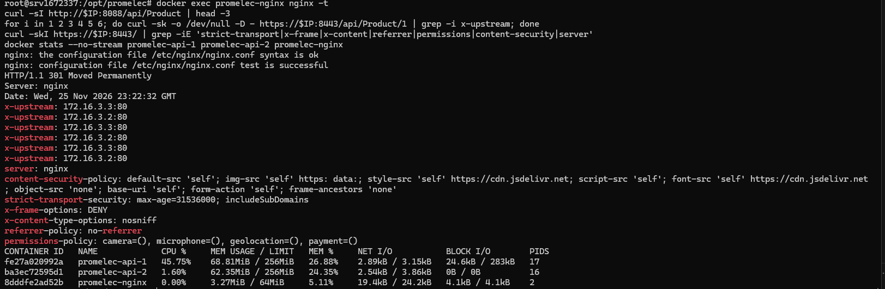

El destino de la redirección: toda petición por HTTP (puerto 8088) se envía a la misma ruta por HTTPS (puerto 8443).

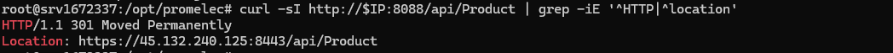

## 5. Balanceo de carga

Seis peticiones seguidas se reparten por turnos (*round robin*) entre `172.16.3.2` y `172.16.3.3`, las dos instancias de la API.

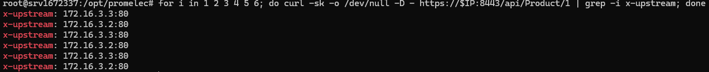

## 6. Cabeceras de seguridad en el navegador

La página principal responde **200 por HTTP/2** con todas las cabeceras de seguridad. La fila `favicon.ico` responde 401 porque la API **deniega por defecto** cualquier recurso que no esté permitido de forma explícita (H-01).

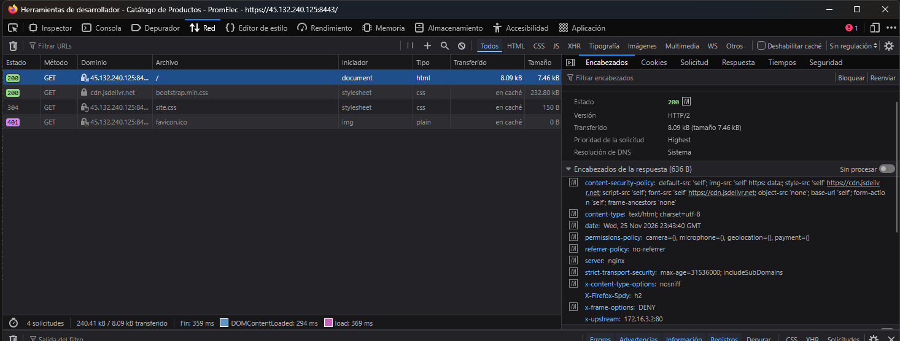

Otra recarga de la misma página: [06b-cabeceras-seguridad-navegador.png](06b-cabeceras-seguridad-navegador.png).

## 7. Tolerancia a fallas

Con `promelec-api-2` detenida, las cuatro peticiones responden `HTTP/2 200`. Cuando Nginx intenta la instancia caída, reintenta solo en la otra; por eso `x-upstream` muestra dos direcciones.

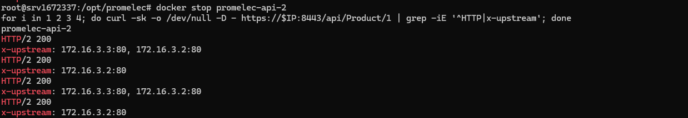

## 8. Recursos

Cada instancia usa menos del 30 % de su límite de 256 MB y Nginx unos 3 MB de 64 MB. En total, menos de 150 MB, sin afectar a los demás servicios del VPS.

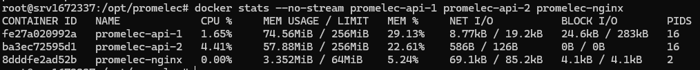

## 9. Catálogo publicado

El catálogo, servido por HTTPS en el puerto 8443. El navegador marca "No seguro" porque el certificado es autofirmado (no hay dominio); la conexión sí está cifrada.

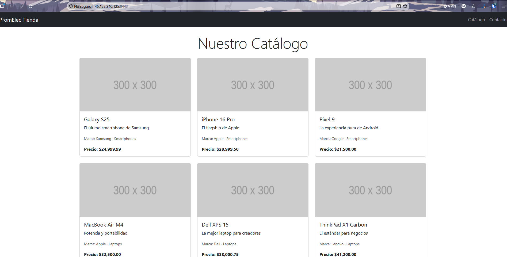

## 10. Imagen publicada en Docker Hub

El repositorio público [`marianasilcam05/promelec-api`](https://hub.docker.com/r/marianasilcam05/promelec-api), del que el VPS descargó la imagen. Tiene las etiquetas `1.0`, `1.1` y `latest`; `latest` apunta a la versión actual, la 1.1 (digest `sha256:717c3dadb…`, 93.5 MB comprimida). Cualquiera puede obtenerla con `docker pull marianasilcam05/promelec-api:1.1`.

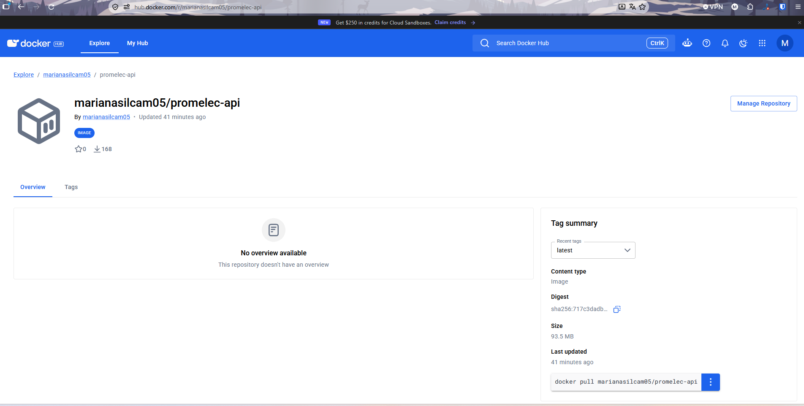

---

> Las capturas no muestran secretos: ni el contenido del archivo `.env`, ni la contraseña del Admin, ni llaves privadas.
